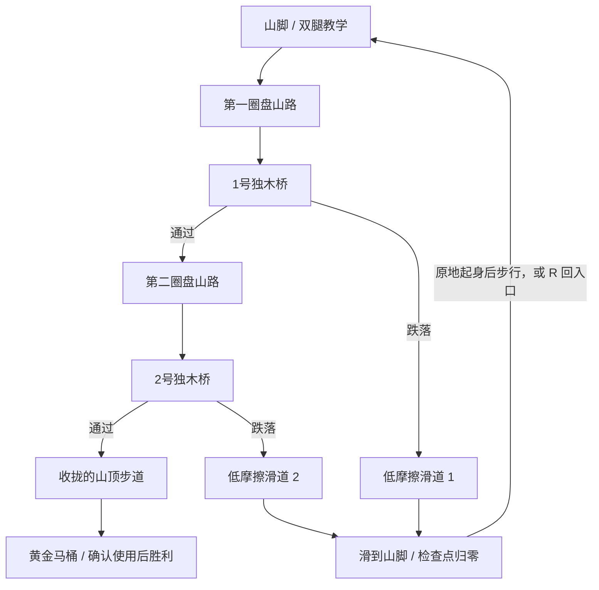

# 场景设计：便便山 · 掉桥直达山脚

日期：2026-10-31。适用项目：Teach-Dario2Toilet。此设计取代旧版的直线山路、遗迹与踏石组合；物理控腿、第一人称、便意和黄金马桶交互继续保留。

## 场景与体验

远处是一座棕色、层层卷起的便便山，山体由三个圆润的大卷与顶部弯曲尖端构成。浅黄色盘山路绕山两圈，越往上半径越小，最终接入 22 米高的山顶平台。黄金马桶放在平台上，是全场景的终点地标。

路线经过两座真正的圆柱独木桥。每座桥下都有一条向山外下降的宽滑道，滑道一路直通山脚，不接回中途平台。桥上失足后，Dario 落进滑道，失去站立控制，以布娃娃姿态持续滑回山脚，登山检查点归零。

## 空间参数

以下参数对应当前实现，仍可按试玩调节。路线 s 是 0–180 的设计进度，不是严格的弯曲道路弧长。

| 内容 | 参数 |
| --- | --- |
| 山体中心 | 世界 X=0、Z=-18，Y 向上 |
| 盘山段 | s=0–164，绕山两圈，半径从 18m 收到 4m，高度从 0m 升至 22m |
| 顶部连接段 | s=164–180，从最后一圈接入山顶平台 |
| 道路宽度 | 起步段 3.4m，其余约 2.5m |
| 山顶平台 | 6×6m，顶部 Y=22m |
| 黄金马桶 | 平台北侧，保留前方安全交互站位 |
| 1号独木桥 | s=56–64，直径 0.90m |
| 2号独木桥 | s=114–122，直径 0.76m |
| 滑道宽度 | 下层 11m，上层 8m，覆盖桥的侧向跌落范围 |
| 滑道入口 | 上端比桥面低 0.75m，向山内扩展 3m；山体视觉与碰撞同时开口 |
| 滑道终点 | 沿山外方向伸至山脚，终点地面 Y≈0 |
| 滑道材质 | 摩擦约 0.025，边缘有低挡边 |
| 山脚 | 半径 43m 的安全地面，容纳两条滑道出口 |
| 检查点 | 0、12、28、48、68、90、108、128、146、164、180 |

桥段将盘山弧线替换为端点之间的直线，真实碰撞采用带坡度的圆柱，不在下方加隐藏路面。滑道由斜面与边缘挡板组成，入口对山体开出缺口；山体碰撞由切口后的可见三角网格生成，不能用凸包把入口重新封死。

## 跌落与滑行规则

1. 角色从桥面侧边下降进入桥下滑道入口范围时，进入 `sliding`，清空脚部输入，中断起身。
2. 身体保持 15 个动态刚体与持久身体关节，放松站立驱动，接触滑道后由重力与低摩擦下滑。
3. 保留有上限的水平导向力，帮助布娃娃沿沟槽向下并留在滑道内；不施加向上的承重力，也不把角色位置直接写到山脚。
4. 滑行期间不能通过 WASD、选脚或 R 起身、回中途检查点。可观察、Esc 暂停；暂停后恢复原来的滑行状态。
5. 落入滑道即清除本次登山检查点并记一次模型迭代，保存山脚进度，避免刷新回到桥前绕过惩罚。
6. 到达滑道末端后退出滑行，留在实际落点。安全稳定后自动起身；可从山脚重新步行，也可按 R 回山脚入口。
7. 普通道路上的跌倒仍按原地起身规则处理，不把所有摔倒都强行转成滑道回滚。

这是一条可见且连续的下山路径；相机跟随真实眼位下降，保持无强制横滚的舒适处理。文案显示“模型回滚！直达山脚”，到地面后提示“登山进度归零”。

## 技术实现

- `model.ts`：螺旋 route、路线切向朝向、带高度权重的最近路线投影。进度不能继续使用 `-body.z`，否则绕山时会回退或错误跳过圈层。
- `terrain.ts`：盘山路、桥梁、山脚、滑道与挡板共享参数，计算滑道局部纵向进度、横向偏移和坡面高度。
- `art/builders.ts`：生成卷曲山体；切除滑道入口附近的山体三角面，使视觉与碰撞同时留出空间。
- `art/layout.ts`：共享道路和山体布局，配置路牌、检查点与黄金马桶。
- `world.ts`：对可见山体生成三角网格碰撞；桥、道路与滑道保留参数化碰撞。
- `slide.ts`：识别跌落入口、布娃娃滑行导向、到达山脚与材质恢复。
- `main.ts`：接入 sliding 生命周期、暂停恢复、检查点归零和叙事提示。

新地图使用独立存档键 `teach-dario:poop-mountain:v1`（数据结构 version=2）。旧地图进度不映射到新山路中的空中位置；旧档若迁移，只保留历史统计并从新地图山脚开始。

## 验收

- 总览可同时辨认便便山形、两圈盘山路、两座桥、桥下滑道与山顶黄金马桶。
- 单独验证各座桥从山内侧与山外侧跌落，均能落入对应滑道并实际抵达山脚。
- 检查身体位移逐物理步连续，没有检查点传送伪装成滑行；滑道口不会被山体碰撞卡住。
- 滑行期间不自动起身，不推进上山检查点，不接受 R 抄近道；暂停与刷新行为符合规则。
- 盘山进度通过空间与高度共同识别，上下层路线重叠时不能误判。
- 黄金马桶继续要求实际接近、面向、稳定支撑和确认交互，不以走到某个 Z 坐标直接通关。

当前自动检查命令以新项目 README 和 VALIDATION.md 为准。旧直线地图的完整路线回放不能作为新盘山路的通关证据。
