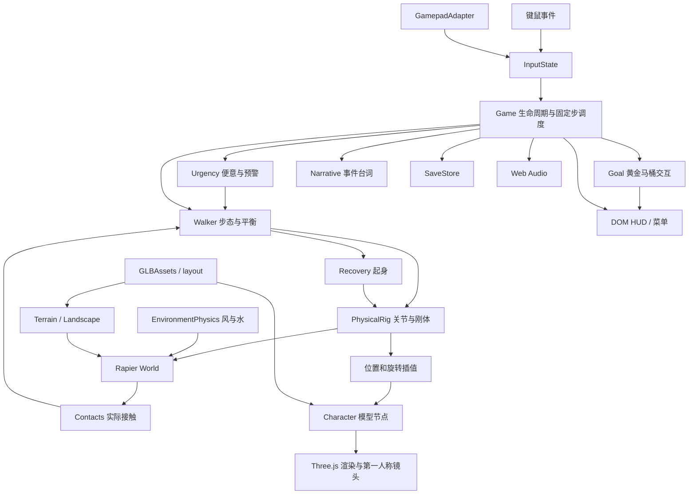

# 《重生之我教 A➗ Dario 做人：登顶马桶》

从零 Vibe Coding 技术开发文档

> 版本：2.0 · 日期：2026-10-31  
> 目标读者：使用 Codex、Claude Code 或其他 AI 编程工具，从空目录重建本项目的开发者。  
> 依据：用户提供的世界观，以及当前仓库的 README、src、tests、tools 和现有技术说明。本文是新世界观下的目标开发规格。现有工程可复用部分标为“现有基础”；第一人称、便意、黄金马桶、主题化关卡与结算属于“新增需求”，不表示已经实现。新增数值为首轮调参建议，须通过试玩确认。本文没有重新执行游戏测试。

> **场景更新（2026-10-31）**：便便山、盘山路、桥下滑道和滑回山脚规则见 [场景设计](SCENE-DESIGN.zh-CN.md)，优先于本文旧直线路线与检查点布局。

## 1. 要做出的产品

游戏正式名称为《重生之我教 A➗ Dario 做人：登顶马桶》，类型是荒诞搞笑的**第一人称动作冒险游戏**，采用物理步行作为核心操作。`Teach-Dario` 保留为工程目录名；现有应用名「一步一脚印 · Baby Steps」和 npm 包名 `baby-steps` 是旧版工程标识，界面文案应切换为新主题，内部包名可暂时沿用。

Dario 重生了。他立志创立 A➗、打造 Claude、成为 AI 大主教，但实现 AGI 之前，他必须先学会走路，并在便意失控前到达山顶的黄金马桶。玩家就是 Dario 的双腿：鼠标分别控制左右脚，WASD 调整重心，在独木桥、悬崖山径和遗迹石阶上挣扎前进。

“每次摔倒都是强化学习，每次坠崖都是模型迭代”是叙事与反馈主题。首版以跌倒、重试统计和事件台词表达，不接入训练系统，不因摔倒暗中改变控制参数。核心口号：**AGI 可以等，马桶不能等！想教 AI 做人，先教 Dario 上厕所！**

### 1.1 体验支柱

| 支柱 | 玩家感受 | 开发落点 |
| --- | --- | --- |
| 我就是双腿 | 知道要怎么走，却仍会笨拙失衡 | 左右脚独立控制、可见下半身与落点、真实接触 |
| 便意催命 | 越接近目标越着急，操作也开始发抖 | 可读的便意阶段、预警、有限步态扰动 |
| 山顶有救 | 一直知道为什么往上爬 | 黄金马桶地标、方向提示、登顶交互 |
| 失败也好笑 | 摔倒像一次荒诞的模型迭代 | 倒地台词、重试编号、结算报告与冲水音效 |

核心体验循环：

```text
观察山路与马桶方向 → 选脚 → 移重心 → 拖动落点 → 松开并实际接地
       ↑                                          ↓
       └──── 前进 / 到达检查点 / 便意升级与预警 ────┘
                         ↓ 失衡或坠崖
               “强化学习”反馈 → 原地起身 / 检查点迭代
                         ↓ 到达峰顶
                 接近黄金马桶 → 确认入座 → 冲水结算
```

交付范围：本地运行、第一人称全身物理、键鼠和标准映射手柄、便意与有限失控、悬崖山径、检查点、自动起身、本地存档、主题化 UI 与音效、黄金马桶终点、GLB 资产和自动验证。

### 1.2 现有基础与改造边界

| 项目 | 现有基础 | 本文目标 / 新增需求 |
| --- | --- | --- |
| 镜头 | 第三人称跟随、距离缩放、遮挡检测 | 第一人称为默认游玩镜头，低头看脚、受限头部跟随、防穿模与舒适设置 |
| 角色与操作 | 15 刚体、左右脚、重心、跌倒和起身 | 复用控制骨架，支持第一人称身体可见性与便意驱动的有限目标扰动 |
| 关卡 | 180m 山路、石阶、窄墙、圆木、踏石 | 保留距离骨架，加入悬崖之字山径与主题标识；首版“攀爬”通过迈步上石阶实现 |
| 压力系统 | 无便意机制 | 新增固定步便意、阶段预警、可复现痉挛与重试缓冲 |
| 终点 | 到达路线终点即完成 | 山顶黄金马桶、有效交互范围、入座演出和冲水结算 |
| 呈现 | 休闲登山文案 | Dario 独白、A➗ 路牌、模型迭代计数、便意 HUD 与搞笑结算 |
| 存档与测试 | v1 存档、现有步行回放与浏览器脚本 | 新主题 v2 存档迁移；新增第一人称、便意与终点测试 |

首版不包含双手抓点、自由攀岩和跳跃系统；悬崖通过真实有碰撞的山径与错层石阶攀登。如果后续扩展手攀岩，需要独立设计抓点约束、操作分配和防坠规则。

本版不需要账号、数据库、云存档、多人同步、服务端游戏逻辑或外部 AI API。`tools/serve.mjs` 是本地静态文件服务，附带 `/api/health`，不是业务后端。首次安装依赖需要网络；完成构建后的游戏资源来自本地，不依赖 CDN。离线运行仍需要 HTTP 服务，不能直接双击 HTML。

## 2. 开发范围与完成标准

建议把目标拆成三档，并始终保留通往最终物理模型的接口。

| 档位 | 交付内容 | 进入下一档的条件 |
| --- | --- | --- |
| 可玩原型 | 第一人称灰盒、可见双腿、完整动态身体、选脚、重心、倒地和重置 | 低头能判断落点，连续小步可行，无明显穿模或强制翻滚 |
| 玩法完整 | 分段路线、便意、悬崖山径、检查点、起身、暂停、存档、黄金马桶交互 | 便意可恢复、路线可通行、刷新安全续玩、入座才通关 |
| 成品化 | Dario 与马桶 GLB、主题 UI/台词、环境、手柄、生产构建 | 新世界观功能、浏览器与生产包验证通过 |

不要把「按键让胶囊体向前移动」作为最终步行系统，也不要先做整座山后补角色物理。原型阶段可以使用 Three.js 基础几何体显示刚体，但身体应尽早采用最终的关节结构。

### 最终验收清单

- 默认第一人称；低头可见双腿与落点；不渲染会遮挡视线的自身头部和背包内侧。
- 便意随有效游玩时间升级，暂停冻结；失控有预警、上限和重试缓冲，不吞键、不反转输入。
- 登顶后必须接近并确认使用黄金马桶；单纯越过 180m 不触发胜利。
- 跌倒、坠崖和通关触发对应主题反馈，同类台词有冷却，字幕可独立阅读。

- 左右脚独立操作；同一时间只有一个输入来源拥有选脚控制权。
- 按住拖脚时镜头冻结，松开后恢复观察；落点方向取选脚瞬间的镜头朝向。
- WASD 只调整重心，不直接平移角色或改写脚部目标。
- 身体始终为动态刚体，腿长固定；空中没有无接触升力或方向控制。
- 实际落脚后才计步，原地点击、倾斜、倒地和起身不刷步数。
- 真正存在窄墙、圆柱桥面与踏石间隙，碰撞形状与视觉相符。
- 暂停时停止物理、起身和有效时间；恢复后不追算后台时间。
- 跌倒可原地起身；重置、刷新续玩从安全检查点恢复。
- 资源加载失败有文件名与重试入口，存储失败不阻止游玩。
- 1280×720 和 1920×1080 均可操作，生产包无非预期外网资源请求。

## 3. 技术栈与工程初始化

以下版本来自当前 `package.json`，作为新主题版本的工程基础，不代表对最新版本的判断。精确依赖树以 `package-lock.json` 为准。

| 层 | 技术 / 当前声明 | 用途 |
| --- | --- | --- |
| 语言 | TypeScript `~5.9.3`，strict 模式 | 类型与模块边界 |
| 构建 | Vite `^6.1.0` | 开发服务与静态打包 |
| 渲染 | Three.js `^0.180.0` | 场景、相机、阴影、GLB |
| 物理 | `@dimforge/rapier3d-compat` `0.21.0` | WASM 刚体、碰撞、关节电机 |
| UI | DOM + CSS | 首页、HUD、暂停、结算 |
| 单测 | Vitest `^3.2.4` | 输入、物理与存档验证 |
| 浏览器验证 | Playwright `^1.64.1` | 真实鼠标、手柄模拟、布局和生产包 |
| 音频 | Web Audio API | 本地合成音效 |
| 存档 | localStorage | 检查点、统计与设置 |

运行环境按项目 README 使用 Node.js 20+，浏览器需要 WebGL2；键鼠操作需要 Pointer Lock。现有浏览器脚本使用 Playwright 的 `channel: 'chrome'`，执行机器需有可用 Chrome，或明确修改脚本的浏览器配置。

在全新目录初始化的参考命令：

```bash
npm init -y
npm pkg set type=module
npm install three@0.180.0 @dimforge/rapier3d-compat@0.21.0
npm install -D typescript@5.9.3 vite@6.1.0 vitest@3.2.4 playwright@1.64.1 @types/three@0.180.0 @types/node@20
```

这些命令固定主工具版本，类型包和传递依赖仍需生成并提交锁文件。若直接复现现仓库，使用 `npm ci`，无需重新初始化。

工程配置约定：

- TS：`target=ES2022`、`module=ESNext`、`moduleResolution=bundler`、`strict=true`、`noEmit=true`，包含 DOM 类型。
- Vite：`base: './'`；开发端口 `5190`，`strictPort: true`。
- 构建：先 `tsc --noEmit`，再 `vite build`；Three.js 和 Rapier 分独立 chunk。
- 脚本至少包含 `dev`、`build`、`test`、`preview`、`start`。
- 忽略 `node_modules/`、`dist/`、`.runtime/`；提交源码、锁文件、必要 GLB 和模型清单。

## 4. 系统架构与文件职责



下表沿用现有模块边界，并标出新增模块；`urgency.ts`、`goal.ts`、`narrative.ts` 是建议新增文件，目前并不存在。从零实现时优先保证可读性。

| 文件 | 单一职责 / 主要契约 |
| --- | --- |
| `src/main.ts` | 初始化资源和 Rapier；Game 编排输入、固定步、状态、保存与 UI |
| `src/model.ts` | FootId、Phase、RunState、路线函数、检查点、距离常量 |
| `src/input.ts` | 按键别名、选脚归属、鼠标位移累计与一次性消费 |
| `src/gamepad.ts` | 标准手柄采样、死区、扳机迟滞、暂停后的解锁条件 |
| `src/rig.ts` | 人体尺寸质量、15 个刚体、14 个身体关节、角度和力矩限制 |
| `src/contacts.ts` | 读取真实接触、法线、载荷、表面速度 |
| `src/walker.ts` | 选脚、目标检测、摆腿、重心辅助、落脚事件、倒地识别 |
| `src/swing.ts` | 平地与谨慎步态的时间曲线、抬脚高度 |
| `src/lean.ts` | 平滑倾斜、角度范围、角色相对重心偏移 |
| `src/recovery.ts` | 起身条件、空间检测、连续起身过程与中止 |
| `src/terrain.ts` | 参数化路段、碰撞体、挑战定义 |
| `src/world.ts` | 灯光、雾、地形实例、环境物件、动态道具重置 |
| `src/environment.ts` | 材质、风阻、浸没比例、浮力、水阻、道具插值 |
| `src/character.ts` | 把物理插值姿态映射到 GLB 驱动节点及脚印提示 |
| `src/camera.ts` | 改造：第一人称眼位、低头视野、无强制横滚、防穿模、FOV 与舒适设置 |
| `src/urgency.ts`（新增） | 便意数值、阶段、确定性扰动、重试缓冲与状态快照 |
| `src/goal.ts`（新增） | 黄金马桶范围、面向与稳定条件、交互、演出完成事件 |
| `src/narrative.ts`（新增） | 主题事件到字幕/音效的映射、优先级与冷却 |
| `src/storage.ts` | 存档解析、校验、旧检查点映射、异常降级 |
| `src/ui.ts` / `src/style.css` | 页面状态、教学提示、HUD 与布局 |
| `src/audio.ts` | 用户交互后解锁音频、合成音效与静音 |
| `src/art/layout.ts` | 资产定义与共享的确定性场景布局 |
| `src/art/GLBAssets.ts` | 模型预加载、节点校验、模板缓存与实例化 |
| `src/art/builders.ts` / `signText.ts` | 程序化模型与路牌文字生成 |
| `tools/` | GLB 导出、静态服务、Windows 启动辅助 |
| `tests/` | 单元、物理、浏览器和完整路线回放 |

`main.ts` 应负责调度，不应承载所有控制算法；不要让 DOM 事件直接改写刚体位置。测试可以直接驱动 Walker，无需每次启动 WebGL。

## 5. 状态与数据契约

### 5.1 游戏生命周期

```ts
type FootId = 'left' | 'right';
type ActivePhase = 'playing' | 'fallen' | 'recovering';
type Phase = 'home' | ActivePhase | 'paused' | 'relieving' | 'finished'; // 目标版新增 relieving
type Landing = 'valid' | 'air' | 'far' | 'blocked';
type Point = { x: number; y: number; z: number };
```

```text
home → 开始 / 继续 → paused → 锁鼠标成功 / 手柄确认 → playing
playing → 身体实际倒地 → fallen → 稳定且空间安全 → recovering
recovering → 完成 → playing
recovering → 遇阻 / 再次失衡 → fallen
任一活动状态 → 暂停 → paused → 恢复之前的活动状态
playing → 黄金马桶可交互且确认使用 → relieving → 演出结束 / 跳过 → finished
活动状态 → R → 当前检查点的 playing
```

`paused.previous` 保存暂停前的活动状态，起身中暂停不能恢复成普通游玩。目标版另外允许暂停 `relieving` 演出，需将可恢复状态类型扩为 `ActivePhase | 'relieving'`。键鼠等待锁定失败时继续显示暂停；手柄模式无需请求鼠标锁定。演出中禁用迈步输入、冻结便意，确认键可跳过，完成事件只能触发一次。

### 5.2 输入契约

| 操作 | 键鼠 | 手柄标准映射 |
| --- | --- | --- |
| 左 / 右脚 | 按住左 / 右鼠标键 | 按住 LT / RT |
| 落点 | 按住选脚键后拖动 | 选脚时右摇杆 |
| 落脚 | 松开选脚键 | 松开扳机 |
| 重心 | WASD / 方向键 | 左摇杆 |
| 观察 | 未按选脚键时移动鼠标 | 未按选脚键时右摇杆 |
| 第一人称视野 FOV | 设置页滑杆；滚轮默认无作用 | 菜单中设置，游玩时十字键不再缩放距离 |
| 使用黄金马桶 / 跳过演出 | F（仅对应提示出现时） | A / ×（仅对应提示出现时） |
| 暂停 / 继续 | Esc / 界面按钮 | Start / Options |
| 检查点重试 | R | Y / △ |

必须保留的细节：

1. `owner` 记录 `Mouse0 | Mouse2 | PadLT | PadRT`；只有拥有者可以释放当前脚。
2. 先按的脚优先。另一个已按住的键不会在当前脚释放后自动接管，必须松开重按。
3. 选脚瞬间锁存 `dragYaw`；拖动期间转镜头不能改变落点坐标系。
4. 鼠标每像素映射 `0.0035m`，累计位移消费后清零，**不乘 dt**。手柄是速度输入，必须乘固定步 dt。
5. WASD 与方向键同向别名不叠加，反向抵消，斜向归一化；Q/E 完全无效。
6. 暂停、失焦、跌倒、起身完成、重置清空输入。手柄需扳机松开且摇杆回中后重新启用，避免旧输入继续作用。
7. 扳机阈值：按下 0.55，释放 0.35；摇杆径向死区 0.18；右摇杆最大落点速度 0.65m/s。
8. 手柄断连自动暂停，重连需再次确认；非标准映射明确提示并保留键鼠入口。

### 5.3 存档与版本迁移

**现有基础**：当前主键 `baby-steps:save:v1`，独立静音键 `baby-steps:muted:v1`。

```ts
interface LegacySaveV1 {
  version: 1;
  checkpoint: number;       // 当前检查点数组索引
  checkpointMeters: number; // 地图演进时按距离映射
  elapsed: number;          // 有效游玩秒数
  falls: number;
  steps: number;
  maxProgress: number;
  best: number | null;
  muted: boolean;
  finished: boolean;
}
```

每五秒、进入检查点、暂停及退出时保存。继续游戏恢复安全检查点与统计，不保存空中姿态或道具中间位置。解析必须捕获 JSON 错误，验证有限数值、计数、布尔值和检查点范围；旧版检查点 `[0,12,64,122,180]` 按距离迁移。localStorage 读写失败时显示提示，游戏仍可进行。

目标版建议使用新主键 `teach-dario:save:v2` 与 `version: 2`，保留原 v1 数据以便回退。读取时优先验证 v2；没有有效 v2 时尝试迁移合法 v1，迁移成功后写入新键。

```ts
// 目标版契约；继承经校验的旧进度字段，不表示当前已有此类型。
interface SaveV2 extends Omit<LegacySaveV1, 'version'> {
  version: 2;
  legacyBest: number | null;      // 旧档 best，仅作历史展示；继承的 best 用于新版
  urgency: number;                // 有限数值，范围 0–100
  maxUrgency: number;             // 本局最高便意，范围 0–100
  urgencyActiveSeconds: number;   // 压力系统固定步时钟，非墙上时间
  retryCount: number;             // “模型迭代”计数，与原地跌倒分开
  checkpointUrgency: number;     // 最近检查点的便意快照
  spasmSeed: number;              // 可验证范围内的整数，复现扰动序列
  spasmClock: number;             // 游玩中的扰动时钟
  comfort: { fov: number; cameraBob: boolean; reducedMotion: boolean };
}
```

旧档迁移保留检查点、时间、跌倒、步数和静音；新便意与最高便意默认 15，不按旧版累计游玩时间补算压力，重试数归零，扰动时钟从零开始、种子重新生成；旧 best 写入 legacyBest，新版 best 初始为 null。恢复设置需验证 FOV 范围、布尔值及所有计时字段的有限性和非负性。旧版 `best` 保留为历史记录，新版含便意与马桶交互的成绩单独计算，不能直接与旧版最佳通关时间比较。

R、坠崖、溺水和刷新续玩统一走安全恢复入口：身体和道具重置，便意恢复为 `min(checkpointUrgency, 65)`，获得 8 秒不触发痉挛的缓冲；刷新不重置已保存的有效时间与重试统计。首次抵达检查点，将便意降低 10 并保存快照，同一检查点不能反复刷减压。新游戏从 15 开始。

黄金马桶演出属于短暂过渡，不保存半途姿态：进入演出前保存检查点及数据；刷新后回到山顶安全平台重新交互。演出成功或跳过后才写入 `finished=true` 和新版最佳成绩。

## 6. 物理与步行控制实现

这是重建的关键。Three.js 负责显示，Rapier 的刚体状态是身体姿态的权威来源。IK 只计算关节目标，关节电机和有限力推动实际身体；不能用 IK 结果直接覆盖鞋和骨盆位置。

### 6.1 固定步顺序

物理步长 `1/120s`，渲染使用 `requestAnimationFrame`。当前主循环限制单帧时间为 0.08s，每渲染帧最多处理 10 个固定步。

```text
渲染帧：采样手柄 → 累积活动时间
  固定步：
    urgency.step(dt, phase) // 新增：便意与有界扰动，先于控制求解
    消费输入、更新意图落点与执行目标
    environment.beginStep()
    walker.step(dt)       // 依据上一物理步接触，计算本步控制
    environment.step(dt)  // 风、水等环境力
    physics.step(hooks)   // 关节、碰撞与动力学求解
    walker.postStep(dt)   // 读取本步接触、落脚、倒地
    消费事件 → 更新计数、检查点、便意快照与主题反馈
    goal.update() → 检查马桶交互资格；胜利由演出完成事件触发
  插值各部位位置与四元数 → 映射美术 → 更新镜头 → 渲染
```

暂停时不跑固定步；继续时清空 accumulator 并重置时间基准。所有身体部位和动态道具都要插值，不能只插值骨盆。位置用 lerp，旋转用 quaternion slerp。

### 6.2 身体结构

约 1.8m、总质量 80kg，背包作为躯干上的附加碰撞体和质量。15 个动态刚体：

```text
Pelvis → Torso → Head
           ├─ Shoulder_L → Elbow_L → Hand_L
           └─ Shoulder_R → Elbow_R → Hand_R
Pelvis ────┬─ Thigh_L → Shin_L → Shoe_L
           └─ Thigh_R → Shin_R → Shoe_R
```

14 个持久身体关节。膝、肘为有范围的铰链，其余使用受限角度和最大力矩的关节电机。这个数量不包括控制器的辅助摩擦关节。身体相邻部位禁用相互接触，其他部位保留自碰撞。

关键尺寸：大小腿各 `0.43m`，骨盆参考高 `0.99m`，鞋中心高 `0.045m`，踝点参考高 `0.11m`。关节锚点必须从世界参考点转换为各刚体的局部坐标，避免初始姿态产生巨大约束误差。关节角度范围和质量分配以 `src/rig.ts` 为准。

现有实现对 Rapier 0.21 的部分关节使用 typed wrapper 和底层 joint limits 接口。重建时先写单关节实验确认电机、角度范围和最大力矩确实生效，再组装全身；不能只凭类型检查认定 API 行为正确。

### 6.3 足部控制与落点判断

足部至少记录：实际位置、目标、支撑位置、起步原点、是否接地、是否抬起、待落地点、步态计时、法线和载荷。当前 Foot 还保存插值、速度、准备时间和落地稳定时间。

推荐处理流程：

1. `lift(id)`：复制实际脚位为原点和初始目标，进入准备移重心。
2. `moveTarget(id, delta, dragYaw)`：转换到世界坐标，并限制在骨盆水平半径 0.85m 内。
3. `assess()`：对当前执行目标向下射线找地面，排除自身和传感器；检查髋踝距离与腿长；用形状扫掠检测路径障碍。
4. `land(id)`：松键后进入下降，不直接设置鞋的位置，也不直接宣布接地。
5. `postStep()`：读取碰撞接触；符合下降时序、位置和有效位移条件后，生成一次 Footfall。

目标版需分离 `intentTarget`（输入累积的意图）与 `executionTarget`（意图加有界便意扰动，再受范围限制的控制目标）；无痉挛时二者相同。提示脚印显示执行目标，痉挛时用细轮廓保留意图位置，避免玩家误以为输入失效。扰动结束平滑归零，不能把偏移永久累积到意图。

落点显示：绿色 `valid`，黄色 `far`，红色 `air / blocked`。0.85m 是目标光标的范围，不等于人体能跨出的距离。高差、身体姿态和障碍会进一步限制可达性。

当前计步要求目标与实际落脚均相对原点有超过约 0.05m 的水平位移；应通过有意义的接触事件驱动计步、音效和尘土，避免每帧接触重复计数。

### 6.4 步态与重心

平地抬腿与目标移动重叠执行，抬脚高度随步幅约 0.20–0.30m；台阶、窄处和高差采用更谨慎的抬膝、越边、下降流程，台阶目标抬脚高度约 0.40m。当前平地时间参数为抬起 0.16s、移动 0.26s、下降 0.18s；谨慎步态为 0.32s、0.50s、0.32s。它们是控制曲线参数，实际运动仍受刚体与接触约束。

重心控制先计算质量加权质心和速度，再根据真实支撑接触确定支撑中心。玩家倾斜经过约 0.18s 的平滑响应，前倾意图上限约 40°，后倾和侧倾约 25°，松开回正。目标位置可用于关节参考和有限力控制，禁止直接平移人物去追目标。

保留有限游戏辅助：

- 只有实际支撑接触时才提供虚拟承重力和姿态力矩。
- 支撑力与力矩有上限，水平力受摩擦限制。
- 对动态承载物施加反作用，避免站在物件上时凭空获得推进。
- 辅助载荷与 Rapier 实际接触载荷分别记录。
- 鞋底摩擦补偿不能变成位置焊接或竖直锁定。

这是人体控制的近似，不是逐条肌肉的生物力学仿真。关掉辅助后应自然倒下；空中全身质心应按重力和动量演进。

### 6.5 倒地、起身与重置

倒地应识别已发生的身体接地，不能通过「倾斜超阈值就推倒」制造结果。倒地后放松驱动，保持动态碰撞和身体关节。

稳定后尝试起身：搜索半径约 0.5m 内的双脚落点，高差不超过约 0.3m，检查站立上方空间。约 4s 内连续收腿、撑起、站稳；遇阻等待或中止，暂停可冻结过程。禁止起身时瞬移、切换运动学刚体或清空速度。

R 重置是明确允许的检查点传送：恢复身体参考姿态、速度和道具初始状态。普通跌倒和原地起身保留已改变的道具位置。

### 6.6 新增：第一人称身体镜头

默认镜头位于 Dario 眼部，世界位置取 Head 的插值位置加眼位偏移；观察 yaw/pitch 由玩家输入决定，不直接继承头部完整旋转。重心方向仍相对身体朝向，落脚方向仍相对选脚瞬间镜头。镜头可以环顾，身体朝向变化由步态控制器处理，不能旋转相机就把全身刚体一起瞬间旋转。

首轮参数建议：垂直 FOV 75°、可设 65°–95°；俯仰约 -70° 到 +85°（以抬头为负、低头为正）；近裁面约 0.03m。低头必须看见鞋和执行目标。自身头部、头发及遮挡眼位的背包网格在主视图隐藏，但保留物理碰撞及必要投影；身体其他网格保持由插值刚体驱动。调试用第三人称可保留为开发入口，不出现在默认操作流程。

镜头从上一个安全眼位向期望眼位做小球扫掠，排除自身碰撞体，并检查近裁面与墙面的安全距离；初始化或检查点重置时重新求安全眼位。相机防穿模不能推着人物移动。贴墙、窄处、摔倒与起身都需要浏览器验证。

为避免物理布娃娃直接带来眩晕，默认不继承头部横滚，限制垂直震动并做短时平滑；不使用强制摇镜、突然 FOV 拉伸或绕人物旋转。跌倒仍可从眼位下降、地平线变化与字幕中感知；舒适模式关闭额外步行晃动和痉挛视觉抖动。暂停菜单提供 FOV、晃动和减少动态效果设置，物理难度不随舒适设置变化。

### 6.7 新增：便意升级与双腿失控

以下是一套可实现的首版规则，数值为待试玩校准的初值。便意 `U ∈ [0,100]`，仅在 `playing`、`fallen`、`recovering` 的固定步中累积。首页、暂停、隐藏页面、入座演出与结算冻结，禁止用 Date.now 补算后台压力。

基础增长建议 `0.08 点/秒`，约 10 分钟增加 48 点；跌倒本身不额外加罚，以免玩家因失误不断进入不可恢复状态。检查点减压与重试缓冲规则见 5.3。

| 阶段 | 便意 | 反馈 | 对步行控制的影响 |
| --- | --- | --- | --- |
| 还能谈 AGI | 0–29 | 平静独白、基础状态条 | 无额外扰动 |
| 开始对齐括约肌 | 30–59 | 黄条、轻微腹鸣、阶段字幕 | 无额外扰动，先建立预警认知 |
| 双腿出现幻觉 | 60–84 | 橙条、痉挛倒计时提示 | 每 12 秒一次，0.8 秒前预警，0.6 秒脉冲，水平目标偏移不超过 0.015m |
| AGI 可以等 | 85–100 | 红条、急促独白与更强音效 | 每 8 秒一次，同样预警与时长，水平目标偏移不超过 0.03m |

`U=100` 保持最高压力阶段，首版不立即判负，玩家始终可以尝试到达马桶。叙事张力来自可控失衡风险；排泄倒计时和额外失败结局不在本版范围内。

实现约束：

1. 痉挛以固定步时钟和保存的种子生成方向；用平滑脉冲作用于当前摆动脚的执行目标，不改按键、不交换左右脚、不自动松脚，不叠加多个脉冲。
2. 没有摆动脚时只播放预警与反馈，不移动支撑脚；暂停前已触发的脉冲冻结，失焦清输入后取消当前脉冲，之后按正常间隔重新调度。
3. 扰动后重新做范围限制和落点检查，允许脚印变黄或变红并明确提示；不可把无效目标显示为绿色，也不保证每次痉挛仍有安全落脚点。
4. 空中、倒地与起身不施加痉挛控制力，但便意可增长；手动和自动重试后重排计时，确保完整 8 秒缓冲。
5. 便意只改变目标参考，不直接加位移、落脚冲量或空中推力，不突破关节、腿长与摩擦限制。
6. 舒适模式只关闭视觉晃动，便意数值和脚部扰动规则相同。调试可冻结便意，但不影响正式成绩规则。

调度接口建议 `Urgency.step(dt, phase)`、`onCheckpoint(id)`、`onRetry()`、`snapshot()`；通过参数把 `spasmOffset` 交给 Walker，避免便意模块直接持有 Rapier 刚体。便意阶段切换、预警和脉冲开始各发一次事件。

### 6.8 新增：黄金马桶与胜利流程

终点不再由 `s >= LENGTH - 0.4` 直接调用 finish。到达 180m 只解锁山顶检查点；玩家还要沿平台走到黄金马桶。

黄金马桶周围配置独立交互锚点、面向方向与安全站位。首轮条件：`phase=playing`、到交互锚点水平距离 ≤1.2m、视线方向与马桶夹角 ≤45°、至少一只脚真实接地、骨盆速度 <0.5m/s，且不在拖脚或待落脚状态。用射线验证视线未被墙遮挡；提示“按 F / A 使用黄金马桶”。条件不符时不消耗确认输入，菜单确认与游玩交互按状态分发。

确认后进入 `relieving`，清输入、冻结便意与成绩计时，执行约 2 秒的入座镜头和冲水音效，然后只触发一次完成事件。首版可以淡出遮罩加声音表达入座，保留世界物理姿态，不必新增动态坐姿求解，也不把演出当作正常步行中的瞬移。允许跳过，跳过走相同完成路径。结算展示：登顶用时、有效步数、强化学习次数（跌倒）、模型迭代次数（检查点重试）、最高便意与“AGI 延期，排队结束”。最高便意需新增运行统计及存档字段 `maxUrgency`，取值 0–100。

## 7. 地图、环境与美术资产

### 7.1 路线

世界单位为米，Y 向上，前进方向大体为 -Z。`route(s)` 给出路径中心，`s` 在当前地图中对应 `-z` 的纵向进度；横向弯曲后实际路径弧长并不严格等于 s。

| 区域 | 距离 | 几何重点 |
| --- | --- | --- |
| 重生训练场 | 起点至遗迹前 | “先学走路再谈 AGI”；宽地面、低头看脚、鼠标迈步教学 |
| 预训练遗迹 | 24–44m | 台阶高差与抬膝；“参数不能替你抬腿”路牌 |
| 对齐悬崖 | 48–62m | 窄墙改为贴崖折线山径；外侧真空隙、内侧岩壁，补充向上石阶 |
| 上下文独木桥 | 78–90m、96–108m | 圆柱曲面、空谷与可视便意预警 |
| 幻觉踏石 | 136–162m | 真实离散支撑，名称是笑点，不隐藏或伪造碰撞 |
| 人类终极智慧峰 | 至 180m 及终点平台 | 黄金马桶地标、安全交互平台、入座冲水结算 |

检查点：`[0,12,22,46,64,74,94,110,122,134,164,180]`。每个挑战前提供宽平台。只有角色位于合理路线横向和高度范围内才推进检查点，不能仅按 z 坐标授予完成。

以上为目标版关卡主题；现有 48–62m 仍是窄墙，贴崖岩壁与上升石阶需新增，并同步修改 route、地形参数、GLB 和路线测试。向上台阶高差须受真实腿长约束，不能仅靠更换名称就宣称完成攀爬。

黄金马桶从中后段至少一个视点可辨认；被地形遮挡时用方向箭头而非穿墙高亮代替导航。挑战前的平台承担教学与便意预警缓冲，不把高压力定时触发与首次狭桥教学强行绑定。

地形从 `trailBlocks()` 参数生成可视物与对应碰撞。桥梁采用锚定圆柱碰撞，水面不是地板；禁止加隐藏宽平台掩盖路线不可通行问题。

### 7.2 环境物理

固定环境包括山体、岩石、树干、路牌与旗杆。检查点附近有 22 块动态小石头和 9 根短圆木，质量随密度与几何体积变化。当前材质参数：

| 材质 | 密度 kg/m³ | 摩擦 | 恢复系数 |
| --- | --- | --- | --- |
| 土 | 1700 | 0.85 | 0.02 |
| 石 | 2600 | 0.75 | 0.04 |
| 木 | 620 | 0.65 | 0.06 |
| 橡胶 | 1100 | 0.90 | 0.02 |

环境力采用二次风阻、浸没体积近似浮力、水阻和旋转阻尼；应验证木浮石沉、离开水域不再施加浮力。头部持续浸没约 3s 后触发检查点重置。花草和旗布只做视觉摆动，不包含布料、破碎、植被破坏或流体网格模拟。

### 7.3 GLB 资源管线

运行时目录 `public/models/`；导出目录 `exports/glb/`，包含分件、清单和完整静态场景。现有生产验证预期加载 31 个 GLB；新增黄金马桶及主题道具后，必须按资产清单更新断言，不能沿用固定数量。

角色 GLB 的 15 个驱动节点与刚体同名，且是模型根下的同级节点。美术网格放在驱动节点子级；大小腿标准网格长 1，驱动节点保留 `scale.y=0.43`，运行时不改变腿长。角色面向局部 -Z，不内嵌动画轨道。

加载器需要：预加载进度、HTTP 与解析错误捕获、必需节点唯一性校验、非空网格与有限包围盒校验、模板缓存与实例克隆。失败界面报告具体文件并提供重试入口。缓存几何与材质可以共享；若要只修改一个实例材质，需要先克隆该材质。

路线布局由 `art/layout.ts` 共享给游戏和导出器。路线主体碰撞由 `terrain.ts` 参数生成；修改路线 GLB 轮廓时需同步碰撞参数。环境网格可生成凸包碰撞，镜头遮挡检测使用实际子网格。

```bash
npm run assets:generate  # 写入 public/models
npm run export:glb       # 写入 exports/glb
```

普通构建不重新生成模型。显式生成会覆盖目标文件，手工美术修改应先提交或备份；不要编辑 `dist/models/` 副本。导出工具依赖本地 Vite 与浏览器，需校验 GLB 文件头、自包含资源、节点和回读尺寸。完整场景 GLB 是静态预览，不包含玩法逻辑与 UI。

### 7.4 新增：主题资产、界面与声音

| 内容 | 规格与触发 |
| --- | --- |
| Dario | 保留 15 节点契约，替换服装与下半身造型；第一人称可见鞋腿，头部按视图隐藏 |
| `golden-toilet.glb`（新增） | 金色陶瓷轮廓与水箱；独立交互锚点，实体碰撞不挡住安全站位；加入资产清单及导出验证 |
| 路牌与检查点 | A➗、AGI、Claude 主题文字；检查点称“迭代站”，仍明确提示已保存 |
| 首页 | 完整标题，口号“AGI 可以等，马桶不能等！”；开始按钮“重生，找厕所” |
| HUD | 便意条、阶段名、脚与承重、到山顶进度；跌倒标“强化学习”，重试标“模型迭代”，保留可理解的说明 |
| 跌倒反馈 | “奖励模型：这一步不太行。”；坠崖重试：“模型迭代 +1，腿还没学会。” |
| 便意反馈 | “Claude 可以晚点发布，厕所不能晚点到。”；最高阶段：“停止训练，立即推理最近厕所！” |
| 结算 | 黄金马桶、冲水声、统计报告，按钮“再重生一次”与“返回首页” |

台词为拟定游戏文案。通过事件表配置字幕、优先级和冷却：同类独白至少间隔 12 秒，阶段升级字幕每次进入阶段一次，检查点与马桶提示优先于普通吐槽。预警不能只靠颜色和声音，要有图标或文字；静音仍显示完整字幕。腹鸣、脚步、跌倒、痉挛预警和冲水音效均可本地合成，语音配音属于后续可选资产。

## 8. 从零开发的阶段与 AI 提示词

本节提示词以目标版世界观为准：先完成可控的第一人称步行，再加入压力，最后验证完整主题体验。每轮只实现一个可运行增量。通过后提交 Git，再进入下一阶段。以下提示词可逐段复制到 AI 编程工具；空仓库先使用 A，再推进 B–I。

### A. 工程与最小场景

**交付**：TypeScript、Vite、Three.js、Rapier 初始化，基础地面、灯光、相机、加载失败界面，以及 Vitest。

**验收**：页面无异常，一个动态方块可落地；构建和一条真实物理冒烟测试通过。

```text
从空目录建立《重生之我教 A➗ Dario 做人：登顶马桶》浏览器游戏工程。使用 TypeScript strict、Vite、
Three.js 0.180.0、Rapier compat 0.21.0、Vitest。用原生 DOM/CSS 做 UI。
先阅读 docs/VIBE-CODING-TECH-SPEC.zh-CN.md。只完成阶段 A：
建立可运行场景、异步物理初始化、120Hz 固定步与渲染插值，展示方块落地。
配置 5190 开发端口和 build/test 脚本。暂不做角色控制与完整地图。
运行类型检查、构建和物理冒烟测试，说明改动文件与执行结果。
```

### B. 动态人体与调试

**交付**：model、rig、contacts；15 刚体、14 身体关节、质量尺寸与角度限制，灰盒显示，碰撞轮廓开关。

**验收**：相邻身体不互相挤压；关闭辅助自然倒下；空中重力与动量合理；身体全程动态、腿长不变。

```text
实现阶段 B，只做 PhysicalRig、Contacts 和灰盒人体。按文档建立 15 个动态
刚体和 14 个持久身体关节，实现局部锚点、角度限制、有限最大力矩与碰撞过滤。
先验证单关节电机行为，再组装人体。加入 ?physicsDebug=1 调试显示。
为关节连续性、固定腿长、空中重力和关闭辅助后的自然倒地写行为测试。
不要用每帧 setTranslation 固定人体，不要实现完整步行或美术。
```

### C. 第一人称平地步行闭环

**交付**：input、lean、swing、walker 和第一人称镜头；选脚、低头看脚、落点判断、移重心、实际落脚事件。

**验收**：默认第一人称；低头看清双腿与脚印；贴墙不穿模，无强制横滚；交替小步、原地不计步、双键优先、快速点击恢复均正确。

```text
实现阶段 C，先限制在平地。镜头按 6.6 从眼位渲染，支持低头看脚、自身头部隐藏、
防穿模和舒适模式。鼠标左右键分别选脚，拖动每像素 0.0035 米，
目标相对选脚瞬间镜头，半径上限 0.85 米。WASD 仅控制平滑重心倾斜。
加入真实接触约束下的有限承重与摩擦辅助、关节目标、摆腿和落脚事件。
保持鞋和全身动态。测试输入归属、连续小步、真实接触计步、原地点击、
快速松键、腿长和无接触时无升力。不要通过落脚冲量或直接平移让角色前进。
```

### D. 倒地、起身与暂停

**交付**：RunState 状态流、Recovery、安全空间检测、暂停和鼠标锁定、检查点重置基础。

**验收**：前后左右倒地可恢复；头顶受阻不起身；起身中暂停冻结；失焦清输入；R 能中断起身。

```text
实现阶段 D。识别真实倒地后放松驱动，稳定且存在安全落点与站立空间时，
通过有限力连续起身。实现 home/playing/fallen/recovering/paused/finished 状态。
失焦、页面隐藏或键鼠解锁时暂停，清理输入与累计时间，恢复保留之前活动状态。
测试四向起身、空间受阻、暂停冻结和 R 重置中断；不瞬移起身或切运动学模式。
```

### E. 悬崖路线、检查点与黄金马桶

**交付**：先单独做石阶、贴崖山径、圆木、踏石测试场，再拼接 180m 路线、12 个检查点，以及灰盒黄金马桶交互。

**验收**：真实曲面、间隙和可攀登石阶；检查点安全；走到 180m 不直接通关；交互条件、演出跳过和一次性结算正确。

```text
实现阶段 E。用共享 route(s)、trailBlocks() 和挑战参数生成地形，先验证
单独障碍，再拼接文档路线，补充贴崖岩壁和上升石阶。让台阶触发谨慎步态，
保持圆柱桥面与踏石真实间隙。加入检查点、主题提示和灰盒黄金马桶。
移除按距离直接胜利，按 6.8 实现资格检测、确认、relieving 演出、跳过与完成事件。为平台宽度、桥面曲率、间隙、路径高差写测试。
通过物理步行接口回放路线，记录重试，不允许修改身体位置跳过未到达路段。
```

### F. 便意、叙事反馈、UI 与存档

**交付**：Urgency、Narrative、主题首页与 HUD、暂停/冲水结算、静音、SaveV2、镜头舒适设置持久化。

**验收**：便意增长和痉挛与帧率无关；暂停冻结；预警、扰动上限、重试缓冲正确；v1 迁移与 v2 校验通过；两种分辨率及静音字幕可用。

```text
实现阶段 F。按 6.7 实现固定步便意、阶段预警和有界摆脚扰动，分离意图与执行目标，
不吞键、不反转输入、不在空中或支撑脚上施加痉挛。实现检查点减压、重试缓冲。
按 7.4 补齐 Dario 独白、便意 HUD、强化学习/模型迭代统计与冲水结算，台词有冷却。
按 5.3 实现 SaveV2、旧档迁移、最高便意和舒适设置，存储异常不阻止游戏。
验证 30/60/120Hz 渲染下压力规则一致、暂停冻结、痉挛边界、刷新续玩、损坏存档
和 1280x720/1920x1080 布局。静音时字幕与预警仍完整。
```

### G. GLB 与环境

**交付**：先实现生成与加载管线，再用 GLB 替换灰盒；动态石木、水与风，资源错误重试。

**验收**：驱动节点唯一且匹配，加载后身体不变形；视觉碰撞一致；木浮石沉、道具碰撞传力、重置可复现。

```text
实现阶段 G。建立 layout/builders/GLBAssets 和浏览器导出工具，先让模型生成、
回读校验、加载和失败重试闭环，再替换灰盒。角色使用 15 个同级物理驱动节点，检查第一人称可见性。
新增 golden-toilet.glb 与主题路牌，校验交互锚点、碰撞和资产清单，并更新资源数量断言。
加入确定性摆放的动态石头与短圆木、材质、风阻、水体近似和头部浸没重置。
测试节点契约、资产复用、曲面碰撞、浮力、反作用与道具重置。
显式生成前检查已有美术修改，普通 build 不覆盖模型。
```

### H. 手柄与输入切换

**交付**：GamepadAdapter、标准映射、菜单导航、控制源切换与安全重启输入。

**验收**：虚拟标准手柄启动无需锁鼠标；左右脚可落地；断连暂停；重连不自动恢复；不同控制源不能互相释放脚。

```text
实现阶段 H。接入 standard Gamepad，按文档设置死区、扳机迟滞和固定步落点速度。
与鼠标共享输入 owner，菜单支持十字键与确认返回。暂停后要求扳机松开、摇杆回中。
断连暂停，重连须再次确认。A/× 在马桶提示出现时交互，relieving 中用于跳过；
菜单与游玩确认按状态分发，十字键不再缩放相机距离。
写纯输入测试和虚拟手柄浏览器验证，覆盖来源冲突、
同帧释放再按下、双扳机优先级及无需 Pointer Lock 的开始和继续。
```

### I. 生产交付

**交付**：构建分包、本地服务、资源校验、浏览器与完整路线验证，运行说明；需要 Windows 分发时补启动器。

**验收**：生产页面正常加载 GLB/WASM，无外部资源依赖；开始、步行、暂停、续玩、手柄、通关均有验证记录。

```text
实现阶段 I。完成生产静态构建与本地服务，正确提供 HTML/JS/CSS/WASM/GLB MIME。
检查相对资源路径。开发测试用 5190，生产测试用 5191，避免访问错服务。
执行类型检查、单元与物理测试、第一人称和便意浏览器验证、生产资源请求检查
及完整路线回放。路线回放需包含马桶交互与演出结束，不能仅断言走到 180 米。
记录命令、结果、截图和未解决问题。补齐 README，不把未运行的检查标记为通过。
```

## 9. 调试与测试策略

### 9.1 建议观察的调试数据

这是重建时的建议仪表，不表示当前界面已全部暴露：左右脚接触和法线载荷、辅助载荷、质心投影、支撑中心、目标足位、关节误差、当前步态阶段、起身失败原因、固定步数和 accumulator；目标版另外显示意图/执行落点、便意阶段、脉冲偏移、重试缓冲、眼位安全距离、终点交互不满足的条件。

| 现象 | 优先检查 |
| --- | --- |
| 人体抖动或关节爆炸 | 锚点坐标、初始重叠、质量与惯量、刚度阻尼、最大力矩 |
| 脚滑 / 人被钉住 | 实际接触、摩擦上限、辅助载荷、是否误加位置约束 |
| 台阶绊住 | 腿长可达性、抬膝时序、扫掠路径、下降是否太早 |
| 换脚死锁 | 松键后的 ready 与 planting 状态、另脚是否真实支撑 |
| 操作随帧率变快 | 鼠标位移是否误乘 dt、手柄速度是否遗漏 dt、位移重复消费 |
| 暂停后人物飞走 | accumulator、旧输入、恢复时间基准 |
| 模型与碰撞错位 | 节点父级、原点、固定缩放、GLB 与地形参数是否一致 |
| 自动测试通关但手玩困难 | 回放允许的重试、步幅、等待时间与真实操作反馈 |

### 9.2 现有检查命令

在项目根目录安装锁定依赖：

```bash
npm ci
npm test
npm run build
```

`npm test` 含物理与路线回放，部分用例允许较长超时。开发迭代可先运行相关测试文件，阶段完成后再跑完整集合。

终端 A 启动开发服务：

```bash
npm run dev
```

终端 B 按变更范围执行：

```bash
npm run test:browser
npm run test:terrain
npm run test:assets
npm run test:stride
npm run test:stumble
npm run test:gamepad
npm run test:route:browser
```

`tests/landing-browser.mjs` 当前没有 npm 脚本别名，需要时用 `node tests/landing-browser.mjs` 执行。多数浏览器脚本固定访问 `http://127.0.0.1:5190/`，不能假设每个脚本都支持 `GAME_URL`。完整路线回放耗时数分钟，应在控制器与地形稳定后执行。

生产验证：完成 build 后，终端 A 执行：

```bash
npm start -- 5191
```

终端 B 执行：

```bash
npm run test:production
```

生产脚本固定访问 `5191`，开发服务则使用 `5190`。本地静态服务端口占用时会尝试后续端口，因此执行验证前确认实际监听地址。Playwright 验证会把截图写入 `.runtime/`。

### 9.3 新主题必须补充的测试（尚未实现）

| 测试组 | 关键断言 |
| --- | --- |
| 第一人称 | 默认眼位、低头可见脚、隐藏自身头部、墙面扫掠、跌倒/起身不强制横滚、FOV 范围 |
| 便意时钟 | 30/60/120Hz 渲染得到相同固定步结果；暂停、演出和隐藏页面不增长；100 封顶 |
| 扰动 | 只作用摆动脚，意图不漂移；上限与预警时长正确；无脚、倒地、起身与空中无扰动力；种子可复现 |
| 压力恢复 | 新检查点只减压一次；R/坠崖/溺水/刷新走统一规则；8 秒缓冲；反复跌倒不会形成永久失控 |
| 主题事件 | 跌倒与重试分别计数；台词冷却和字幕优先级；静音仍有预警 |
| 马桶目标 | 越过终点不获胜；距离/面向/接触/速度/遮挡/脚部状态不符不能交互；演出完成与跳过只结算一次 |
| 存档迁移 | v2 优先；v1 合法迁移；坏值拒绝；演出中刷新回山顶平台；新版与旧版最佳成绩分开 |
| 生产资源 | 新马桶 GLB 加载、节点契约、更新后的资产数量、无外部请求、两种布局 |

建议新增 `urgency.test.ts`、`goal.test.ts`、`first-person-browser.mjs`，并扩展存档与生产脚本；这些名称是待开发测试，不属于现有命令。现有 `full-route-browser.mjs` 依赖旧的距离通关判定，改造后要增加接近马桶、确认及等待演出完成的步骤。

### 9.4 自动验证的边界

现有完整路线回放允许原地起身、检查点重试，以及到新营地后的站姿重置；不跳过尚未到达的路段。这能验证路线碰撞和控制器可行性，但不能证明玩家能一次无失误通关，也不能代表普通玩家通关时间。

软件 WebGL、虚拟手柄和固定脚本不能替代真实设备手感验收。交付前应手动完成：第一人称低头看脚、贴墙、跌倒舒适性、连续小步、快速点脚、转镜头后迈步、悬崖台阶换脚、最高便意下过桥、压力恢复、暂停续玩、真实手柄重连和黄金马桶入座。便意增长速率需以新手通关时间试玩校准，不能仅凭公式判定难度合适。

## 10. Vibe Coding 的协作约定

把本文放在新项目 `docs/` 下，每次会话先让 AI 阅读。建议为重建项目增加以下工程约定；它们是建议，不是当前仓库已有的 AGENTS.md：

```text
先阅读技术文档，声明本轮阶段、改动范围和可观察验收条件。
一次实现一个阶段，先跑通第一人称灰盒步行，再加便意、复杂场景和美术。
以目标版需求为准，现有第三人称、距离通关和 v1 存档不能直接视为最终规格。
便意扰动必须可复现、有预警且有上限，舒适设置不得改变物理难度。
输入、状态、物理和渲染分离；DOM 事件不直接改写身体位置。
120Hz 固定步；全身动态；固定腿长；无接触不提供承重升力。
瞬移和清速度仅限新游戏 / 检查点重置，不用于正常迈步、倒地和起身。
修改物理时优先补或运行针对行为的测试，不能通过放宽断言掩盖问题。
不增加文档范围外的服务与框架；不顺手重构无关模块。
输出改动原因、验证命令及真实结果、剩余问题，然后提交可运行版本。
```

调参时一次只改一组相关参数。先录下可复现的失败动作和固定步数据，再调整关节、摩擦或步态；不要同时提高所有力矩、摩擦与阻尼。每阶段提交一个可运行版本，出现退化时能明确定位到具体阶段。

如果只需要一天内的演示，缩短为一段平地、一组贴崖台阶、一道短独木桥、一个检查点和灰盒黄金马桶。优先完成 A–D，再选做 E 的马桶交互和 F 的简化便意与字幕，保留“第一人称控腿 → 便意预警 → 笨拙过桥 → 冲水结算”的主题闭环。完整 180m、环境和手柄后续迭代。

## 11. 对照源码继续深入

- 产品和运行说明：[`../README.md`](../README.md)
- 状态、路线、距离与检查点：[`../src/model.ts`](../src/model.ts)
- 固定步与生命周期：[`../src/main.ts`](../src/main.ts)
- 人体结构与关节控制：[`../src/rig.ts`](../src/rig.ts)
- 步行与平衡：[`../src/walker.ts`](../src/walker.ts)
- 真实接触：[`../src/contacts.ts`](../src/contacts.ts)
- 起身：[`../src/recovery.ts`](../src/recovery.ts)
- 物理验收边界：[`PHYSICS-VALIDATION.md`](PHYSICS-VALIDATION.md)
- 美术资产契约：[`GLB-ASSETS.md`](GLB-ASSETS.md)
- 路线回放规则：[`../tests/trail-replay.ts`](../tests/trail-replay.ts)
- 生产验证：[`../tests/production.mjs`](../tests/production.mjs)

本文交付的是以新世界观为目标、以现有工程为基础的开发规格和执行路线。第一人称、便意、悬崖改造、主题资产、v2 存档与马桶结算均需后续实现；本次文档修改不代表游戏代码已完成改造。是否达到具体阶段，应以当次实际运行结果和人工手感检查为准。
